# Project UTS MyCookbook Mobile Application
Aplikasi ini merupakan buku resep berbasis digital yang dikembangkan menggunakan Futter dan Supabase sebagai databasenya dalam memenuhi tugas Ujian Tengah Semester (UTS) mata kuliah Pemrograman Mobile. Dengan aplikasi ini, memungkinkan pengguna untuk menjelajahi resep dari REST API public yaitu The Mealdb serta mengelola buku resep digital secara interaktif.

# Identitas Mahasiswa Pengembang
Nama : I Wayan Agus Wredhi Putra
NIM  : 2415051007
Kelas : PTI 5B
Universitas Pendidikan Ganesha

# Daftar Fitur
1. Home Screen sebagai beranda utama aplikasi yang menyambut pengguna dan menampilkan navigasi.
2. Catalog Screen (Katalog) sebagai daftar resep yang diambil dari REST API public dengan fitur search/cari resep.
3. Cookbook Screen (Buku Resep Saya) sebagai halaman yang khusus digunakan mengelola resep yang sudah disimpan (dari Katalog) dan data pada Buku Resep Saya tersimpan dalam database Supabase.
4. Detail Screen sebagai halaman menampilkan informasi rinci dari resep seperti nama resep, kategori, instruksi pembuatan dan tombol Simpan ke Buku Resep dengan pengecekan jika resep sudah tersimpan sebelumnya maka akan muncul snackbar "Resep ini sudah ada di Buku Resep Anda!" 
5. Add Recipe Screen sebagai halaman formulir dilengkapi dengan validasi dalam menambah resep baru pada Buku Resep Saya.
6. Edit dialog sebagai tampilan saat pengguna mengklik tombol untuk mengedit resep di Buku Resep Saya untuk mengedit catatan, status resep, dan tingkat kesulitan.
7. Delete sebagai fitur yang dipanggil melalui tombol sampah pada resep di Buku Resep Saya untuk menghapus resep yang dipilih dan dilengkapi dengan dialog untuk mengonfirmasi apakah yakin ingin menghapus resep tersebut.
8. About Screen sebagai halaman menampilkan informasi profil.
9. Feedback System menggunakan SnackBar untuk notifikasi sukses atau gagal dan AlertDialog untuk konfirmasi tindakan penting.

# Tech Stack
* Framework : Flutter bahasa pemrograman Dart
* State Management : Provider dengan ChangeNotifier
* Backend Database : Supabase (PostgreSQL)
* HTTP Client/Networking : http / Supabase Client SDK
* UI Components : Material Design 3 dan Responsive Layout

# Rest API yang Digunakan
* The MealDB API (`https://www.themealdb.com/api.php`)
* Digunakan untuk mengambil data resep makanan publik.
* Operasi GET diimplementasikan untuk melakukan fetching data JSON dan dikonversi ke dalam Dart Model.

# Backend dan Database
* Database : Supabase (PostgreSQL)
* Tabel Utama : my_cookbook
* Struktur Field : id (Primary Key, int8), recipe_id (text, unique), recipe_name (text), category (text), image_url (text), note (text), difficulty (text), status (text), created_at (timestamptz), instruction (text).
* Operasi CRUD lengkap Create, Read, Update, Delete.

# Struktur Arsitektur Aplikasi 
lib/
├── models/         # Dart Models (Konversi JSON & Entitas Data)
├── services/       # Layanan API & Koneksi Database Supabase
├── repositories/   # Abstraksi dan Pengelolaan Sumber Data
├── providers/      # State Management (Provider & ChangeNotifier)
├── screens/        # 6+ Screen Fungsional Utama
├── widgets/        # Reusable Widgets (Custom Button, Empty State, Recipe Card)
└── main.dart       # Titik Masuk Aplikasi & Root Provider Scope

# 📱 Screenshot Aplikasi & Responsive Layout

Berikut adalah dokumentasi tampilan antarmuka aplikasi Cookbook dalam mode potrait dan landscape :
1. HomeKatalog & Detail Resep
| Mode Potret | Mode Lanskap |
| :---: | :---: |
| 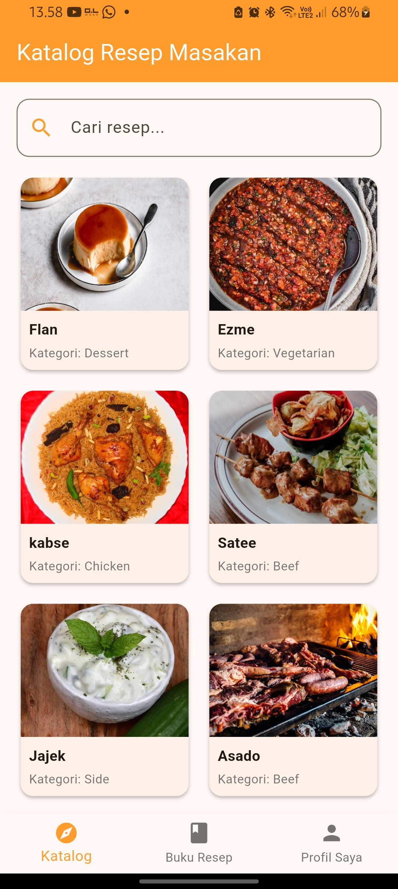 | 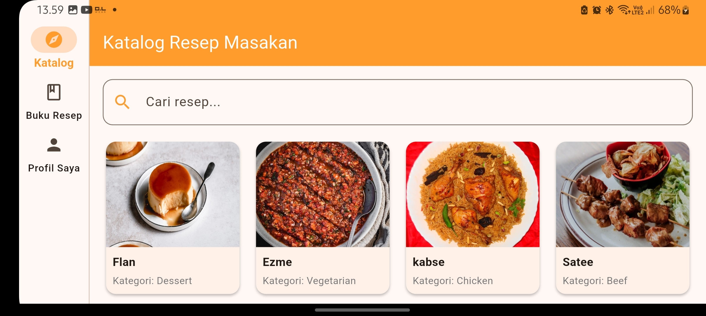 |
| 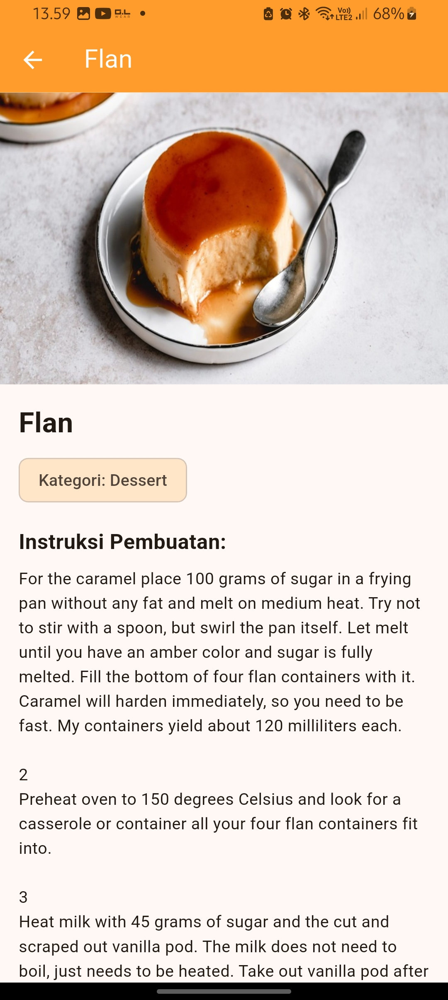 | 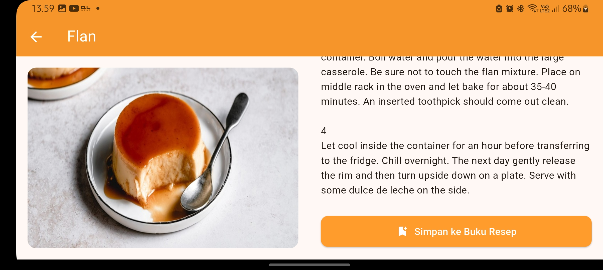 |

2. Buku Resep Saya & Manajemen Data (CRUD)
| Mode Potret | Mode Lanskap |
| :---: | :---: |
| 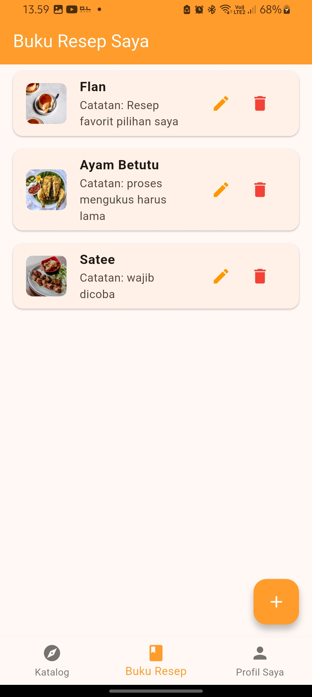 | 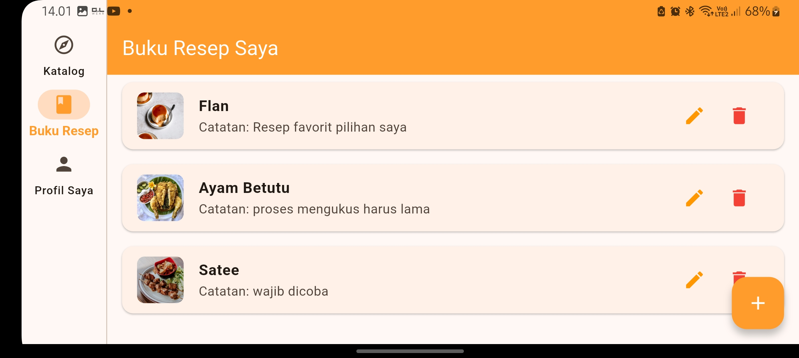 |
| 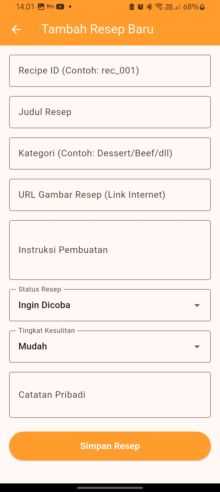 | 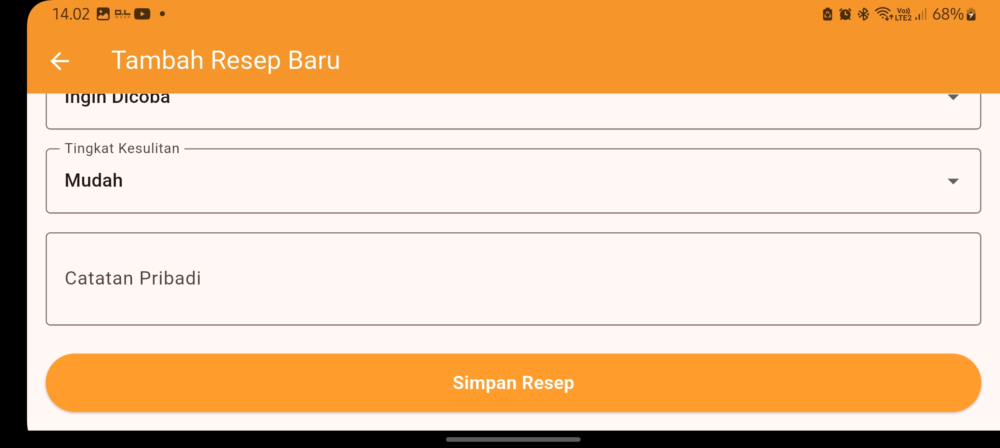 |
| 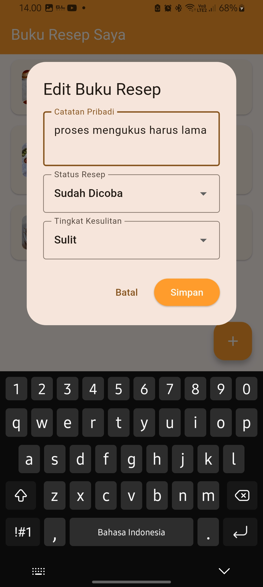 | 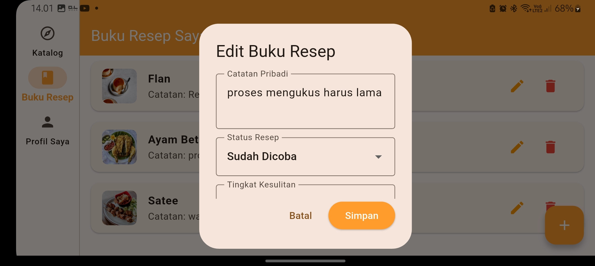 |
| 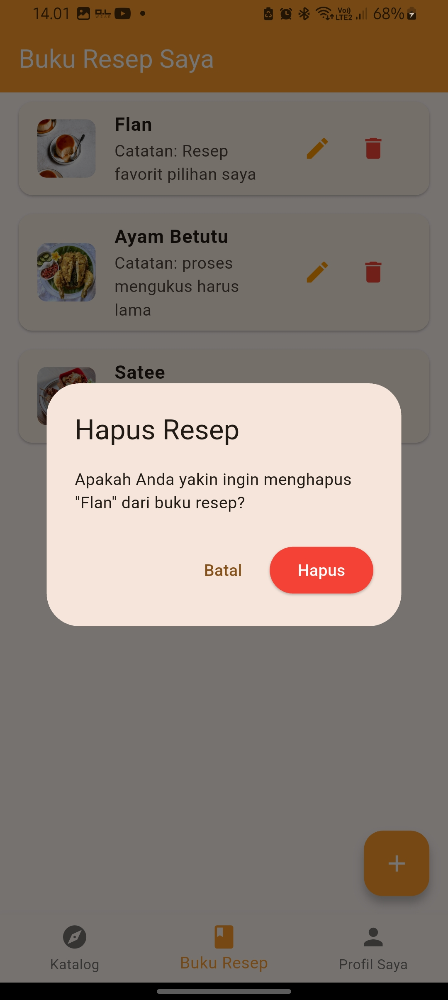 | 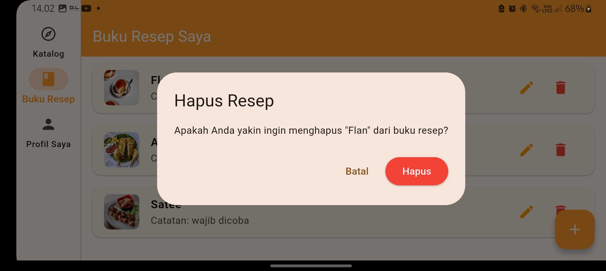 |

3. Profil Saya
| Mode Potret | Mode Lanskap |
| :---: | :---: |
| 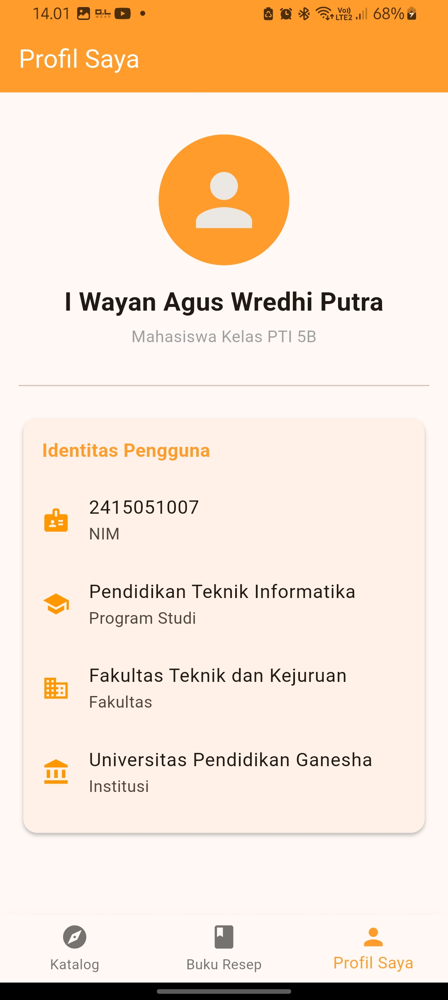 | 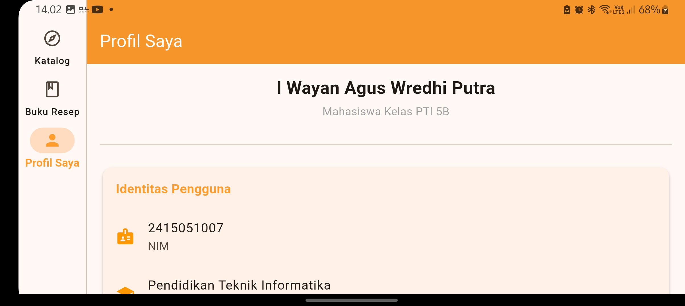 |

# Cara Menjalankan Aplikasi 
1. Clone Repository ini : git clone https://github.com/iwayanaguswredhiputra/UTS_2415051007_I-Wayan-Agus-Wredhi-Putra lalu cd pada terminal
2. Install Dependencies : flutter pub get pada terminal
3. Konfigurasi Supabase : pastikan Anda telah menyiapkan kredensial Supabase (URL dan Publishable Key) di dalam file konfigurasi utama.
4. Jalankan aplikasi : flutter run pada terminal